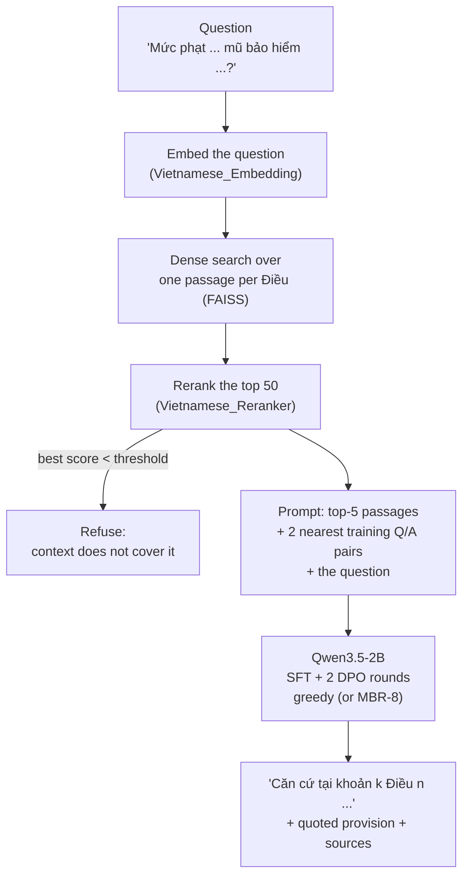
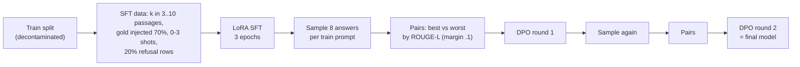
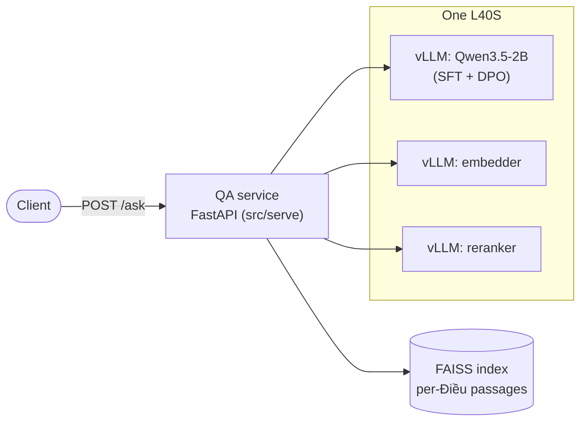

# law-rag

**Ask a question about Vietnamese law. A 2B model finds the right Điều and answers in the register of a legal reference, quoting the provision.**

[](https://github.com/hoangphu7122002/law-rag/commits/main)


```text
Q: Kể từ 01/11/2025, trong bao lâu phải nộp báo cáo giao dịch chuyển tiền điện tử
   phục vụ phòng, chống rửa tiền theo Thông tư 27/2025/TT-NHNN?
A: Căn cứ theo khoản 2 Điều 9 Thông tư 27/2025/TT-NHNN quy định về thời hạn báo cáo ... như sau:
   [...] trước 16 giờ ngày làm việc tiếp theo ngay sau ngày phát sinh giao dịch. [...]
   Sources: 27_2025_TT-NHNN (0.970) · 07_2012_QH13 (0.725) · ...
   Latency: 2.1 s (retrieve 0.15 · rerank 0.20 · generate 1.79)
```
<sub>Q1 of the demo, shortened. It gets the deadline right but cites Điều 9 where the reference cites Điều 10 (ROUGE-L .558): the typical remaining error. All 10 transcripts: [`docs/report/demo.md`](docs/report/demo.md).</sub>

## What and why

This is the RAG assignment of the HCMUT *Large Language Models* course: take a naive RAG baseline for Vietnamese legal QA and make it better, with an answering model **under 4B parameters**.

The reference answers follow a rigid template ("*Căn cứ tại khoản k Điều n ... quy định ...*") and then quote the article almost word for word. So the job is less "know the law" and more "find the right provision, then copy the right amount of it". Every change in this repo was measured against that target with a paired bootstrap, and the ones that did not help are reported too.

| | Cosine | Jaccard | Token overlap | BLEU-1 | ROUGE-L |
|---|---|---|---|---|---|
| Course baseline (test) | .602 | .164 | .191 | .138 | .171 |
| **Final, greedy** (test) | **.916** | **.673** | **.734** | **.582** | **.643** |
| Final + MBR-8 (test) | .918 | .681 | .728 | .587 | .652 |

200 held-out test questions, one generation per question. The full write-up is the [report (PDF)](docs/report/report.pdf).

## Features

| Feature | What you get |
|---|---|
| **A corpus that has the cited laws** | Course texts plus central-government laws since 2000 and every law the answers cite. Law-hit rate goes from 0.00 to 0.62. |
| **Per-Điều retrieval** | One passage per article, a Vietnamese dense embedder, then a cross-encoder reranker. |
| **Supervised register learning** | Qwen3.5-2B fine-tuned on decontaminated pairs, with gold-passage injection, 0–3 nearest-question demonstrations and refusal rows. |
| **On-policy DPO** | Two rounds on the model's own best-versus-worst samples (ROUGE-L reward). Greedy then matches 8-sample MBR. |
| **No test leakage** | Training pairs that cite the same (law, Điều) as a test answer, or share a rare 13-gram with one, are dropped. |
| **Reproducible runs** | One YAML per experiment. Same config, same run directory; runs resume. |
| **A QA service** | `POST /ask` returns the answer, its sources and timings. Three vLLM endpoints, median 2.6 s end to end on one L40S. |
| **Refuses when unsure** | No passage above the reranker threshold means "the context does not cover this", not a guess. |

## Quickstart

Run the whole pipeline on 5 questions with BM25 and a fake LLM. No GPU, no data download, about a minute:

```sh
git clone https://github.com/hoangphu7122002/law-rag.git
cd law-rag
uv sync --extra models --extra dev      # Python >= 3.11, https://docs.astral.sh/uv/
make test                               # unit tests, no data or models
make smoke                              # end-to-end on 5 questions
```

For the real thing, put the course files in `data/raw/` (`Dataset.zip`: 16,441 law texts; `res.csv`: 2,745 question/answer rows, both from the course Drive folder "RAG Assignment") and build the data:

```sh
make data           # unzip, clean, fixed seeded split: test 200 / dev 300 / train 2,245
make vbpl-cited     # extra corpus from the HF dataset th1nhng0/vietnamese-legal-documents
make web            # cited laws still missing, from public portal sitemaps (rate-limited)
```

## How it works

One question, from the request to the quoted answer:



And how the generator was trained:



## Architecture



| Layer | Stack |
|---|---|
| Generator | Qwen3.5-2B, LoRA SFT (PEFT), DPO (TRL) |
| Retrieval | AITeamVN Vietnamese_Embedding, FAISS, AITeamVN Vietnamese_Reranker |
| Serving | vLLM (OpenAI-compatible), FastAPI, Docker Compose in [`docker/`](docker) |
| Experiments | YAML configs, run directories under `data/runs/`, paired bootstrap ([`make compare`](Makefile)) |
| Metrics | Exact port of the course notebook: cosine, Jaccard, token overlap, BLEU-1, ROUGE-L |
| Tests | pytest: unit tests (no data, no models) and a smoke test with BM25 and a fake LLM |

Service details, variables and latency: [`docs/ops/docker.md`](docs/ops/docker.md).

```sh
GPU=0 HF_CACHE=$HOME/.cache/huggingface docker compose -p lawrag-qa -f docker/compose.yml up -d
curl -s -X POST localhost:8080/ask -H 'Content-Type: application/json' \
  -d '{"question":"Mức phạt đối với hành vi không đội mũ bảo hiểm khi đi xe máy là bao nhiêu?"}'
```

<details>
<summary><b>Reproducing every step</b></summary>
<br>

Scripts and `python -m cli` expect `PYTHONPATH=src`. An experiment is a YAML file (`configs/exp/<id>.yaml`, only the differences from `configs/base.yaml`), a backend file (`configs/backends/*.yaml`: where the endpoints are) and `--set key=value` overrides. A run writes `data/runs/<exp>__<hash>/{config.yaml, predictions.jsonl, metrics.json}` and a row in `data/runs/results.tsv`. Start the endpoints as in [`docs/ops/l40s.md`](docs/ops/l40s.md).

```sh
# course baseline (dev; add --set split=test for the report numbers)
make run EXP=configs/exp/B0_baseline.yaml
# retrieval ablations A2a ... A2e, then retrieval-only scores
make run EXP=configs/exp/A2e_dedup.yaml
python -m cli retrieval data/runs/<run>
# SFT data and training
python -m cli sft-data configs/exp/A3_Q3.yaml --name q35_v3b --k-range 3,10 --oracle 0.7 --shots 0,1,2,3 --refuse 0.2
python src/train/sft/sft_lora.py --data data/train/q35_v3b --base Qwen/Qwen3.5-2B --out data/models/q35_v3b --epochs 3 --max-length 12288 --batch 1 --accum 16
# evaluate (serve the model with vLLM first; shots=2 must be explicit)
make run EXP=configs/exp/A5_v3b.yaml ARGS="--set generate.model=data/models/q35_v3b --set generate.shots=2"
make run EXP=configs/exp/A6_mbrv3b.yaml ARGS="--set generate.model=data/models/q35_v3b --set generate.shots=2"   # MBR-8
# on-policy DPO, round 1 (round 2 repeats it from data/models/dpo_a)
python scripts/train/pref_sample.py --data data/train/q35_v3b --out data/train/pref_v3b/cands.jsonl --model data/models/q35_v3b --base-url http://localhost:8001/v1
python scripts/train/build_pairs.py data/train/pref_v3b/cands.jsonl data/train/pref_v3b/pairs.jsonl --min-margin 0.1
python src/train/preference/dpo.py --pairs data/train/pref_v3b/pairs.jsonl --base data/models/q35_v3b --out data/models/dpo_a --lr 2e-5 --beta 0.1
# is A better than B?
make compare A=data/runs/<run_a> B=data/runs/<run_b> METRIC=rouge_l
```

Training needs the `train` extra (`uv sync --extra train`). On one L40S: SFT about 1.3 h, one DPO round about 35 min plus 25 min of sampling, a 300-question dev run 5 min greedy or 12 min with MBR-8. Weights (about 4.6 GB each) are not in git.

</details>

## What did not work

Measured, reported in the [report](docs/report/report.pdf), and left out of the final system:

| Tried | Result |
|---|---|
| Fine-tuning the embedder or the reranker | No gain on answer ROUGE-L |
| Legal-domain or larger base models | Raw models all land at .39–.46; SFT is the step that matters |
| ReAct tool-using agent | Worse than one-shot RAG at 2B (without thinking mode) |
| FP8 weights | 21% lower latency, but −.009 ROUGE-L |
| MBR only when the model is unsure | .644 at 3.1 generations, below plain MBR-8 (.658) |
| A third DPO round | Answers collapse in length; quality drops |
| PiSSA SFT, new pair sets, weight-space edits | Inside the seed noise (up to .016 between identical chains) |
| Perfect retrieval (gold passage injected) | Only +.007: the rest is which khoản to quote and how much |

## Project layout

| Path | What's there |
|---|---|
| [`src/`](src) | `corpus` (data, decontamination) · `index` · `retrieve` · `generate` · `train` (SFT, DPO, GRPO) · `evaluate` · `serve` |
| [`configs/`](configs) | `base.yaml`, one file per experiment in `exp/`, endpoints in `backends/`, GPU job queues in `queues/` |
| [`scripts/`](scripts/README.md) | Entry points by stage: `data/`, `train/`, `analysis/`, `serve/`, `ops/` |
| [`tests/`](tests) | `unit/` (no data, no models) and `smoke/` (pipeline with BM25 and a fake LLM) |
| [`docker/`](docker) | Compose file and API image |
| [`docs/report/`](docs/report) | The paper (LaTeX in `paper/`), the PDF and the demo transcript |
| [`docs/CHANGELOG.md`](docs/CHANGELOG.md) | Every experiment in order, with its numbers |
| [`docs/research/`](docs/research) | Plans and running logs of the later experiments |

[`AGENTS.md`](AGENTS.md) is the entry point for coding agents: rules, layout and conventions.

## Limits

- The metrics measure similarity to template-style references, not legal correctness. **Answers are not legal advice.**
- Greedy decoding in vLLM is not bit-deterministic: identical runs differ by about ±.003 ROUGE-L.
- The corpus is a snapshot. Laws amended after it are not reflected.

## Author

Nguyễn Đắc Hoàng Phú (2670352), supervised by Assoc. Prof. Quản Thành Thơ, Ho Chi Minh City University of Technology.

## License

No license has been chosen yet, so all rights are reserved by default. The course data and the third-party models keep their own terms.
