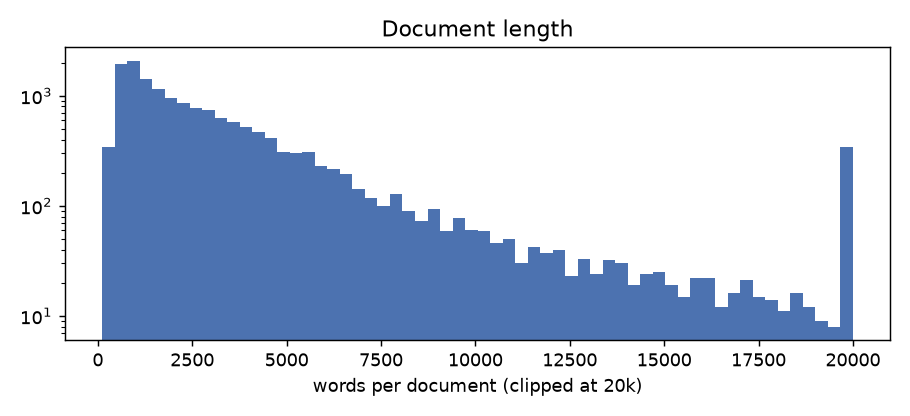
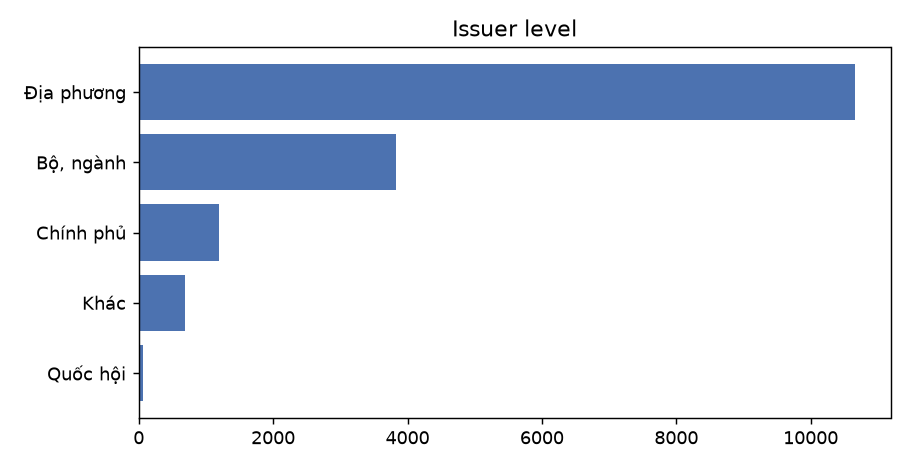
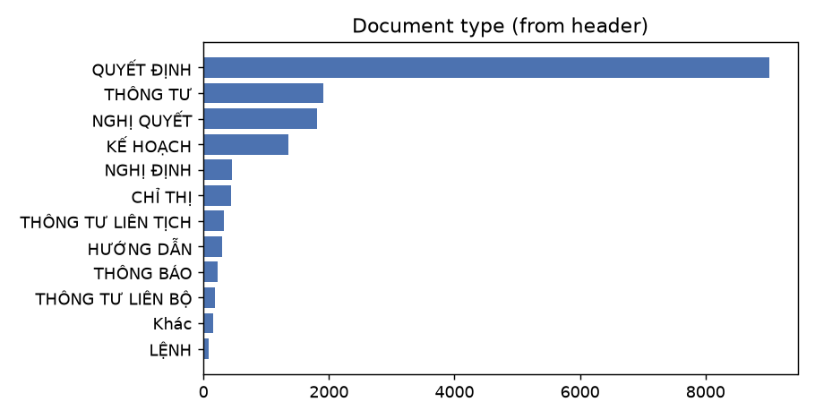
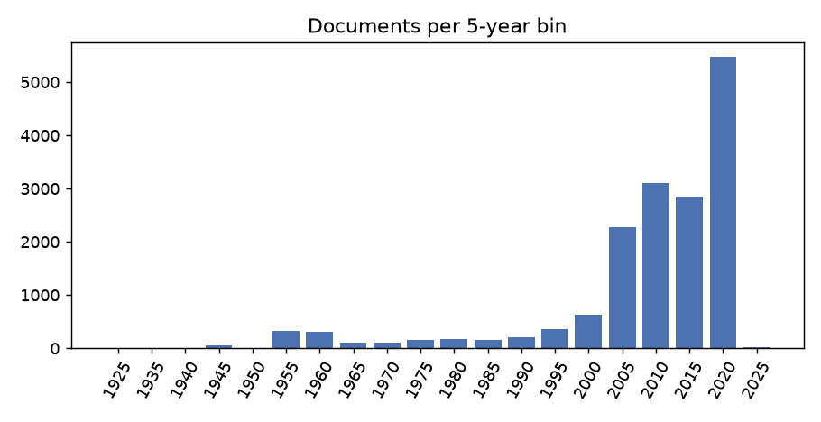

# Corpus exploration

Source: `Dataset.zip` → `data/processed/corpus/`. QA law ids from **train + dev only** (test unseen). Script: `docs/notebooks/01-corpus-eda.py`.

## 1. Size

| metric | value |
|---|---|
| documents | 16,439 |
| total words | 63,144,671 |
| words / doc p10 | 686 |
| median | 2,224 |
| p90 | 7,743 |
| max | 174,257 |
| near-empty docs (< 50 words) | 0 |
| est. 2000-char chunks | 162,471 |

## 2. Issuer level and document type

| level | len | % |
|---|---|---|
| Địa phương | 10,655 | 64.8 |
| Bộ, ngành | 3,829 | 23.3 |
| Chính phủ | 1,196 | 7.3 |
| Khác | 692 | 4.2 |
| Quốc hội | 67 | 0.4 |

| type | len | % |
|---|---|---|
| QUYẾT ĐỊNH | 9,016 | 54.8 |
| THÔNG TƯ | 1,904 | 11.6 |
| NGHỊ QUYẾT | 1,812 | 11.0 |
| KẾ HOẠCH | 1,352 | 8.2 |
| NGHỊ ĐỊNH | 452 | 2.7 |
| CHỈ THỊ | 446 | 2.7 |
| THÔNG TƯ LIÊN TỊCH | 325 | 2.0 |
| HƯỚNG DẪN | 294 | 1.8 |
| THÔNG BÁO | 229 | 1.4 |
| THÔNG TƯ LIÊN BỘ | 179 | 1.1 |
| Khác | 157 | 1.0 |
| LỆNH | 87 | 0.5 |
| BÁO CÁO | 52 | 0.3 |
| QUY ĐỊNH | 45 | 0.3 |
| CHƯƠNG TRÌNH | 32 | 0.2 |

## 3. Issue year

Year found in header for 16,325/16,439 docs; range 1929–2025, median 2015; 2024+: 1,115.

## 4. Structure and noise

| metric | value |
|---|---|
| docs with ≥1 Điều | 12,272 |
| docs with Chương | 2,001 |
| Điều total | 84,222 |
| Điều / doc (median, docs with Điều) | 3 |
| docs with 'Nơi nhận' block | 10,436 |
| chars after 'Nơi nhận' (median) | 2,971 |
| exact duplicate bodies (extra copies) | 0 |
| file names ending _1.._9 (variants) | 4,461 |

Text is copied from HTML: line breaks fall mid-sentence (`Số:\n 002-TT-LB`), so chunkers should flatten whitespace first; the header (quốc hiệu, số, ngày) and the `Nơi nhận` tail are boilerplate.

## 5. Built-in relation metadata (a ready-made document graph)

Every file ends with blocks such as `Van ban duoc can cu:` listing related documents with an ID. 16,297 docs have at least one block; 190,981 edges in total.

| relation | docs having it | edges |
|---|---|---|
| related | 14,743 | 74,029 |
| based_on | 13,207 | 63,911 |
| cites | 6,927 | 23,324 |
| replaced_by | 5,322 | 15,617 |
| replaces | 2,622 | 4,456 |
| amends | 1,948 | 2,725 |
| amended_by | 1,651 | 2,701 |
| guides | 1,537 | 1,753 |
| guided_by | 691 | 1,607 |
| translation | 858 | 858 |

Use: expand retrieval to guiding / amending documents, prefer the newest version (`replaced_by`), no LLM extraction needed (lightweight graph, roadmap phase 4).

## 6. Does the corpus hold the laws the questions cite? (train + dev)

| metric | value |
|---|---|
| QA pairs (train + dev) | 2,545 |
| with a cited law id | 2,545 |
| cited law found in corpus | 48 |
| not in corpus but named in a relation block | 127 |
| distinct cited laws | 305 |

Cited-law year (QA): 2015: 36, 2016: 105, 2017: 11, 2018: 52, 2019: 55, 2020: 40, 2021: 67, 2022: 61, 2023: 94, 2024: 745, 2025: 181

The questions ask about 2024–2025 law that the corpus mostly lacks; this is why `law_hit` is ~0 for B0/A1 and why the vbpl extra corpus is added.
